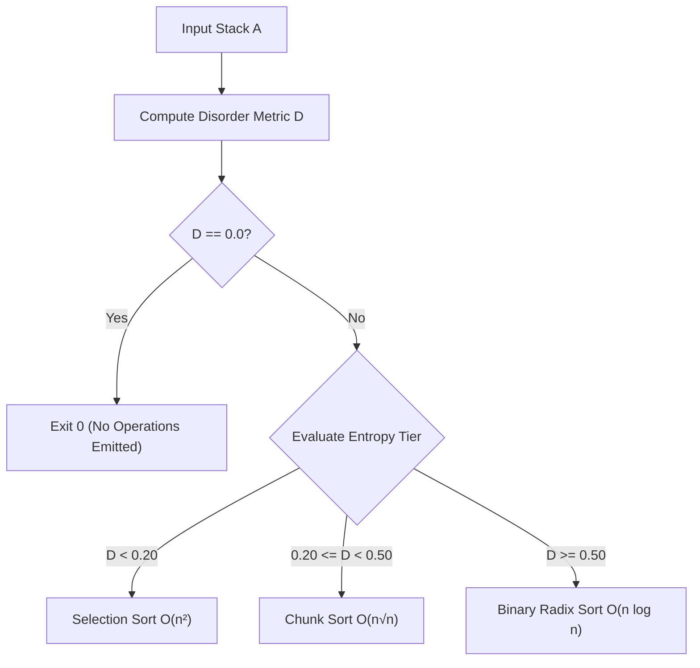
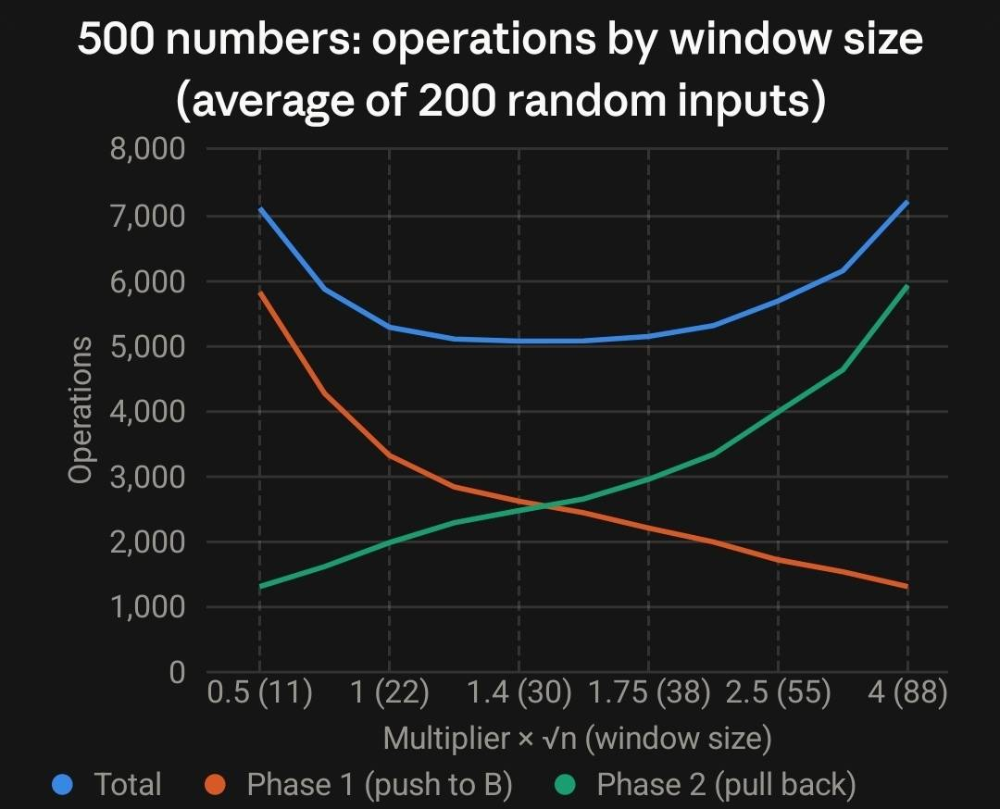
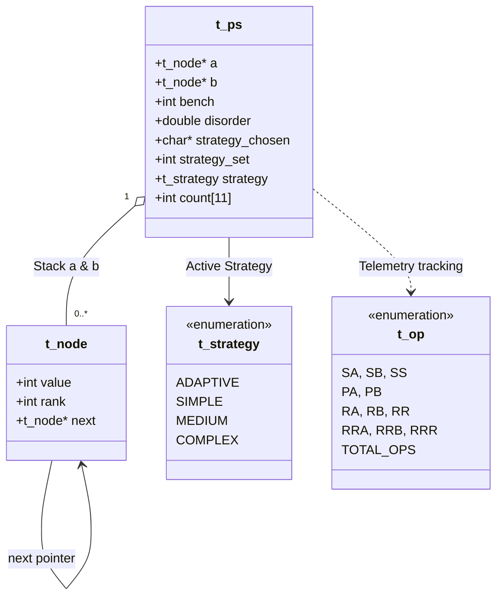

# Push Swap: Adaptive Dual-Stack Sorting Engine

> An algorithmic optimization engine implemented in C that sorts arbitrary integer permutations on constrained dual pushdown automata using minimal instruction sequences.

*Engineered and developed in collaboration by **[Ayham Shalabi](https://github.com/ayhamshalabi)** and **[Huthifa Alomari](https://github.com/Huthifa-Alomari)**.*

---

## Table of Contents

1. [Project Overview](#project-overview)
2. [Dual-Stack Architecture & Instruction Primitives](#dual-stack-architecture--instruction-primitives)
3. [Algorithmic Strategies](#algorithmic-strategies)
   - [Strategy 1: Selection Sort — O(n²)](#1-selection-sort--on2)
   - [Strategy 2: Chunk / Butterfly Sort — O(n√n)](#2-chunk--butterfly-sort--onsqrtn)
   - [Strategy 3: LSD Binary Radix Sort — O(n log n)](#3-lsd-binary-radix-sort--on-log-n)
   - [Strategy 4: Adaptive Disorder-Driven Dispatcher](#4-adaptive-disorder-driven-dispatcher)
4. [Mathematical Modeling: Permutation Inversion Disorder](#mathematical-modeling-permutation-inversion-disorder)
5. [Coordinate Compression (Rank Normalization)](#coordinate-compression-rank-normalization)
6. [Optimal Window Sizing for Chunk Sort](#optimal-window-sizing-for-chunk-sort)
7. [System Architecture & Data Structures](#system-architecture--data-structures)
8. [Telemetry & Benchmarking Engine (`--bench`)](#telemetry--benchmarking-engine---bench)
9. [Empirical Performance Benchmarks](#empirical-performance-benchmarks)
10. [Input Validation & Memory Safety](#input-validation--memory-safety)
11. [Build System & CLI Usage](#build-system--cli-usage)
12. [Verification & Test Workflows](#verification--test-workflows)
13. [Collaboration & Attribution](#collaboration--attribution)
14. [References & Further Reading](#references--further-reading)

---

## Project Overview

Sorting data under arbitrary random-access memory models is trivial ($\mathcal{O}(n \log n)$ comparisons with $\mathcal{O}(1)$ random indexing). However, when memory is strictly partitioned into **two isolated Last-In-First-Out (LIFO) stacks** with no random access and only 11 allowable pointer-manipulation instructions, sorting becomes a complex discrete optimization and shortest-path planning problem.

**Push Swap** is a specialized sorting engine designed to resolve this challenge. Rather than sorting integers in memory directly, the program outputs the shortest possible sequence of hardware-like stack instructions that transforms an arbitrary input permutation in Stack `a` into a strictly sorted ascending stack, leaving helper Stack `b` empty.

### Core Engineering Capabilities

* **Multi-Strategy Complexity Spectrum:** Implements three discrete sorting paradigms spanning quadratic ($\mathcal{O}(n^2)$), sub-quadratic ($\mathcal{O}(n\sqrt{n})$), and log-linear ($\mathcal{O}(n \log n)$) instruction complexities.
* **Pre-Execution Entropy Analysis:** Calculates a normalized permutation inversion metric (the **Disorder Metric**) on the input before mutating state, quantifying disorder between $0.0$ (sorted) and $1.0$ (reversed).
* **Adaptive Dynamic Dispatch:** Automatically profiles incoming datasets and routes execution to the optimal algorithm based on data disorder and distribution entropy.
* **Non-Invasive Diagnostic Telemetry:** Includes a built-in `--bench` instrumentation layer emitting detailed operation distributions and disorder diagnostics to `stderr` without polluting pipeline data on `stdout`.
* **Zero External Dependencies:** Built entirely in modular C with customized I/O buffering and unified file-descriptor-aware formatting.

---

## Dual-Stack Architecture & Instruction Primitives

The virtual machine operates on two homogeneous stacks:
* **Stack `a`:** Primary workspace. Initialized with the input sequence (top element is the first argument). Must contain the fully sorted sequence upon termination.
* **Stack `b`:** Auxiliary scratchpad. Initialized empty; must be completely empty upon termination.

### Permitted Instruction Set (11 Operations)

| Instruction | Category | Semantics |
| :---: | :---: | :--- |
| `sa` | **Swap** | Swaps the top two elements of Stack `a`. No-op if stack size $< 2$. |
| `sb` | **Swap** | Swaps the top two elements of Stack `b`. No-op if stack size $< 2$. |
| `ss` | **Swap** | Atomic execution of `sa` and `sb` simultaneously. |
| `pa` | **Push** | Pops top element of Stack `b` and pushes it onto Stack `a`. No-op if Stack `b` is empty. |
| `pb` | **Push** | Pops top element of Stack `a` and pushes it onto Stack `b`. No-op if Stack `a` is empty. |
| `ra` | **Rotate** | Shifts Stack `a` upward by 1 element. The head node becomes the tail node. |
| `rb` | **Rotate** | Shifts Stack `b` upward by 1 element. The head node becomes the tail node. |
| `rr` | **Rotate** | Atomic execution of `ra` and `rb` simultaneously. |
| `rra` | **Rev Rotate** | Shifts Stack `a` downward by 1 element. The tail node becomes the head node. |
| `rrb` | **Rev Rotate** | Shifts Stack `b` downward by 1 element. The tail node becomes the head node. |
| `rrr` | **Rev Rotate** | Atomic execution of `rra` and `rrb` simultaneously. |

Every printed operation incurs an identical cost of $1$ instruction move. Algorithmic efficiency is measured strictly by total instructions emitted.

---

## Algorithmic Strategies

The engine implements four execution modes selectable via CLI flags (`--simple`, `--medium`, `--complex`, or `--adaptive` by default).

### 1. Selection Sort — O(n²)

* **Flag:** `--simple`
* **Paradigm:** Greedy selection via minimum-distance path search.
* **Mechanism:**
  1. Identifies the smallest remaining rank in Stack `a`.
  2. Calculates whether the target element is closer to the top or bottom of the stack:
     $$\text{Rotations} = \begin{cases} \text{pos} \times \texttt{ra} & \text{if } \text{pos} \le \frac{\text{size}}{2} \\ (\text{size} - \text{pos}) \times \texttt{rra} & \text{otherwise} \end{cases}$$
  3. Rotates the target element to the top and pushes it to Stack `b` (`pb`).
  4. Continues until only 2 elements remain in `a`. Swaps them (`sa`) if out of order.
  5. Unwinds Stack `b` back to `a` via repeated `pa`. Because items entered `b` in ascending order, Stack `b` acts as a reverse buffer, restoring `a` in perfect ascending order.

* **Complexity Analysis:**
  * Extracting rank $k$ requires at most $\lfloor(n - k) / 2\rfloor$ rotations plus one `pb`.
  * Total instructions: $\sum_{k=0}^{n} \frac{n - k}{2} \approx \frac{n^2}{4} + 2n$.
  * **Instruction Complexity:** $\mathcal{O}(n^2)$ | **Auxiliary Memory:** $\mathcal{O}(1)$.
* **Best Use Case:** Small inputs ($n \le 10$) or partially pre-sorted datasets where inversion clusters reside near stack boundaries. For inverted arrays, extracting each element costs only 1 `rra` (~295 instructions for $n = 100$).

---

### 2. Chunk / Butterfly Sort — O(n√n)

* **Flag:** `--medium`
* **Paradigm:** Dynamic sliding-window partitioning with concentric hourglass staging.
* **Mechanism:**
  * **Phase 1: Concentric Ingestion ($a \to b$):**
    Maintains a dynamic sliding window of rank width $W = \lfloor\sqrt{n}\rfloor \times 1.4$. As elements stream through Stack `a`:
    * If `a->rank <= pushed`: Execute `pb`, followed by `rb`. This routes lower-tier elements to the bottom of Stack `b`.
    * If `pushed < a->rank <= pushed + W`: Execute `pb`. This leaves upper-tier elements within the current window sitting at the top of Stack `b`.
    * If `a->rank > pushed + W`: Execute `ra` to cycle the element for a subsequent window pass.
    * Every successful push increments `pushed`, advancing the window bounds dynamically. This organizes Stack `b` into an hourglass shape, where the smallest and largest items reside near opposite poles.
  * **Phase 2: Greedy Maximum Extraction ($b \to a$):**
    Searches for the global maximum remaining rank in Stack `b`. Because of the pre-sorted concentric structure created in Phase 1, the maximum is guaranteed to be within bounded reach of either the top or bottom. The target is rotated to the top using the shortest path (`rb` or `rrb`) and pushed back to `a` (`pa`).

* **Complexity Analysis:**
  * Partitioning costs $\mathcal{O}(n^2 / W)$ rotations while extraction costs $\mathcal{O}(n \cdot W)$ rotations.
  * Setting $W \approx \sqrt{n}$ balances both phases:
    $$T(W) = \frac{n^2}{W} + nW \implies T(\sqrt{n}) = 2n\sqrt{n} = \mathcal{O}(n\sqrt{n})$$
* **Performance Profile:** Peak performer on uniform random inputs. Achieves **~576 instructions on 100 values** and **~5,069 instructions on 500 values**.

---

### 3. LSD Binary Radix Sort — O(n log n)

* **Flag:** `--complex`
* **Paradigm:** Bitwise Least Significant Digit (LSD) partitioning.
* **Mechanism:**
  * Iterates across the binary representation of normalized ranks from bit $0$ (LSB) up to bit $k = \lceil\log_2 n\rceil - 1$ (MSB).
  * For each bit position:
    * Examines the top element of Stack `a`:
      $$\text{bit\_val} = (\texttt{rank} \gg \text{bit}) \ \& \ 1$$
    * If the bit is `0`: Pushes the node to Stack `b` (`pb`).
    * If the bit is `1`: Rotates the node to the bottom of Stack `a` (`ra`).
    * Repeats for all $n$ elements in the stack.
    * Unwinds all elements from Stack `b` back into Stack `a` (`pa`).
  * Because the binary partition is stable, after pass $k$, the array is fully partitioned by its lower $k + 1$ bits.

* **Complexity Analysis:**
  * Number of passes: exactly $\lceil\log_2 n\rceil$ (7 passes for $n=100$; 9 passes for $n=500$).
  * Instructions per pass: $n$ operations in Phase 1 (`pb` or `ra`), plus at most $n$ operations in Phase 2 (`pa`), giving $\le 2n$ instructions per pass.
  * **Instruction Complexity:** $\mathcal{O}(n \log n)$, strictly bounded by $2n \lceil\log_2 n\rceil$.
* **Deterministic Guarantees:** Instruction volume depends exclusively on dataset size $n$, completely unaffected by initial data ordering. Emits **exactly 1,084 instructions for $n = 100$** and **6,784 instructions for $n = 500$**.

---

### 4. Adaptive Disorder-Driven Dispatcher

* **Flag:** `--adaptive` *(Default)*
* **Paradigm:** Heuristic meta-sorting via pre-computed entropy analysis.
* **Mechanism:**
  The adaptive engine evaluates the normalized disorder score $D \in [0.0, 1.0]$ of the input stack prior to performing any mutations. The dataset is routed according to empirical performance boundaries:



| Inversion Tier | Disorder Range | Dispatched Strategy | Operational Rationale |
| :---: | :---: | :---: | :--- |
| **Low Disorder** | $D < 0.20$ | **Selection Sort** | Near-sorted datasets feature minimum elements positioned close to stack boundaries, requiring fewer operations than chunk setup overhead. |
| **Moderate Entropy** | $0.20 \le D < 0.50$ | **Chunk Sort** | Exploits semi-structured sequences efficiently; sliding windows minimize rotation penalties. |
| **High Entropy** | $D \ge 0.50$ | **Binary Radix Sort** | Provides strict, predictable upper bounds without susceptibility to worst-case rotation paths. |

---

## Mathematical Modeling: Permutation Inversion Disorder

To quantify the degree of disorder of an input sequence before any stack modification, we utilize the normalized count of permutation inversions.

An **inversion** is defined as any pair of elements $(a_i, a_j)$ such that $i < j$ and $a_i > a_j$:

$$\text{Inversions}(A) = \sum_{1 \le i < j \le n} \mathbf{1}_{\{a_i > a_j\}}$$

The maximum possible number of inversions occurs when the sequence is sorted in strict descending order:

$$\text{Total Pairs} = \binom{n}{2} = \frac{n(n - 1)}{2}$$

The **Disorder Metric** $D$ is the normalized quotient:

$$D(A) = \frac{\text{Inversions}(A)}{\text{Total Pairs}} = \frac{2 \sum_{i < j} [a_i > a_j]}{n(n - 1)}$$

### Properties
* **Bounded Domain:** $0.0 \le D(A) \le 1.0$.
* **Sorted Identity:** $D(A) = 0.0 \iff A$ is strictly ascending.
* **Reverse Identity:** $D(A) = 1.0 \iff A$ is strictly descending.
* **Expected Random Value:** For a uniform random permutation chosen from the symmetric group $S_n$, the expected disorder is exactly:
  $$\mathbb{E}[D] = 0.50$$
* **Algorithmic Cost:** Computed in $\mathcal{O}(n^2)$ time with $\mathcal{O}(1)$ auxiliary memory directly on the linked list before sorting begins.

---

## Coordinate Compression (Rank Normalization)

Raw user input consists of signed 32-bit integers spanning $[-2147483648, 2147483647]$. Arbitrary values create challenges for bitwise and windowed algorithms due to sign bits and sparse distributions.

Before executing any sorting routine, our engine applies **Coordinate Compression** (`initialize_ranks` in `stack_utils.c`):

$$\text{rank}(x) = |\{y \in A : y < x\}|$$

```
Raw Input Values:   [  42,  -7,  900,  15  ]
Normalized Ranks:   [   2,   0,    3,   1  ]
```

### Why Coordinate Compression Matters
1. **Dense Non-Negative Domain:** Maps all values to the continuous integer interval $[0, n - 1]$.
2. **Deterministic Radix Passes:** Radix sort bit-width is bounded strictly by $\lceil\log_2 n\rceil$ bits instead of requiring 32 bit-passes.
3. **Continuous Windowing:** Chunk sort can slide windows across exact arithmetic ranges $[pushed, pushed + W]$ without gap checks.
4. **Preserved Invariants:** The relative order of all elements is perfectly preserved, guaranteeing that sorting the ranks sorts the original values.

---

## Optimal Window Sizing for Chunk Sort

In Chunk Sort, total operations are governed by the chunk width parameter $W$. Let $W = c\sqrt{n}$. The theoretical cost function is:

$$T(c) = \frac{n^2}{c\sqrt{n}} + c n\sqrt{n} = \left(\frac{1}{c} + c\right) n\sqrt{n}$$

Differentiating with respect to $c$ and setting to zero yields the theoretical minimum at $c = 1.0$. However, on practical stacks, asymmetric rotation penalties occur during Phase 2 extraction because extracted nodes leave holes in the remaining stack.

We conducted empirical simulations across 200 random permutations per coefficient step $c$ on $n = 500$ integers to calibrate the optimal constant:



| Multiplier $c$ | Window Size ($n=500$) | Phase 1 Moves | Phase 2 Moves | **Total Instructions ($n=500$)** | **Total Instructions ($n=100$)** |
| :---: | :---: | :---: | :---: | :---: | :---: |
| $0.50$ | 11 | 5,804 | 1,295 | 7,099 | 727 |
| $0.75$ | 16 | 4,274 | 1,596 | 5,870 | 645 |
| $1.00$ | 22 | 3,306 | 1,970 | 5,277 | 594 |
| $1.25$ | 27 | 2,826 | 2,261 | 5,088 | 579 |
| **$1.40$** | **30** | **2,607** | **2,447** | **5,054** | **578** |
| $1.60$ | 35 | 2,322 | 2,750 | 5,072 | 581 |
| $1.75$ | 38 | 2,187 | 2,946 | 5,133 | 584 |
| $2.00$ | 44 | 1,977 | 3,299 | 5,276 | 597 |
| $3.00$ | 66 | 1,525 | 4,628 | 6,153 | 674 |

### Mathematical Finding
At **$c = 1.40$**, Phase 1 ingestion costs and Phase 2 extraction costs reach equilibrium (~2,500 moves each), delivering the global minimum of **~5,054 instructions** for 500 integers. This formula ($W = \lfloor\sqrt{n}\rfloor \times 1.4$) is baked directly into `sort_medium.c`.

---

## System Architecture & Data Structures

The codebase is organized into isolated functional subsystems, preventing direct manipulation of linked list pointers outside the operations layer.

```
push_swap/
├── Makefile                 Build configuration with dependency rules
├── README.md                Technical architecture & benchmarks
├── push_swap.h              Core types, macros, and function prototypes
├── libft/                   Utility primitives (memory, strings, parsing)
├── ft_printf/               Custom I/O engine with multi-fd & float support
└── srcs/
    ├── main.c               Program entry point & orchestration
    ├── parsing/             CLI parsing, numerical validation, error routing
    ├── stack/               Node allocation, linked list traversal, rank mapping
    ├── analysis/            Disorder metric calculation & benchmark reporting
    ├── ops/                 The 11 stack instruction primitives & telemetry hooks
    └── sort/                Sorting implementations (simple, medium, complex, adaptive)
```

### Core Memory Models



* **`t_node`:** Singly linked stack node. Stores the initial `value`, computed `rank`, and forward pointer `next`.
* **`t_ps`:** Master controller state allocated on the call stack in `main()` with zero heap overhead.
* **Encapsulated Operations:** Functions like `op_rotate(ps, 'a')` validate stack boundaries, mutate pointers, increment internal counters (`ps->count[RA]++`), and write the instruction string to `stdout`.

---

## Telemetry & Benchmarking Engine (`--bench`)

When invoked with the `--bench` flag, the engine records runtime metrics and formats diagnostic output directly to **stderr** (`fd = 2`).

```sh
$ ./push_swap --bench 4 67 3 87 23 > /dev/null
[bench] disorder: 40.00%
[bench] strategy: Adaptive / O(n√n)
[bench] total_ops: 13
[bench] sa: 0 sb: 0 ss: 0 pa: 5 pb: 5
[bench] ra: 0 rb: 2 rr: 0 rra: 0 rrb: 1 rrr: 0
```

### Stream Isolation
By emitting instructions to `stdout` (`fd = 1`) and diagnostic telemetry to `stderr` (`fd = 2`), benchmark mode maintains complete pipeline compatibility:

```sh
# Instruction output is piped to validation checker while telemetry is redirected to log
./push_swap --bench $DATA 2> telemetry.log | ./checker $DATA
```

---

## Empirical Performance Benchmarks

### 1. Uniform Random Distributions

Tested over 60 random iterations ($n = 100$) and 30 random iterations ($n = 500$):

| Algorithmic Strategy | Asymptotic Class | 100 Avg | 100 Max | 500 Avg | 500 Max |
| :--- | :---: | :---: | :---: | :---: | :---: |
| **Selection Sort** (`--simple`) | $\mathcal{O}(n^2)$ | 1,453 | 1,624 | 32,133 | 34,140 |
| **Chunk Sort** (`--medium`) | $\mathcal{O}(n\sqrt{n})$ | **576** | **619** | **5,069** | **5,239** |
| **Binary Radix** (`--complex`) | $\mathcal{O}(n \log n)$ | 1,084 | 1,084 | 6,784 | 6,784 |
| **Adaptive** (`--adaptive`) | Dynamic | 845 | 1,084 | 5,980 | 6,784 |

### 2. Disorder Sensitivity Matrix

Performance of each strategy across controlled disorder levels (generated by seeding sorted arrays and performing targeted shuffle operations):

#### Dataset: $n = 100$ Integers

| Input Disorder $D$ | Selection Sort ($\mathcal{O}(n^2)$) | Chunk Sort ($\mathcal{O}(n\sqrt{n})$) | Radix Sort ($\mathcal{O}(n \log n)$) | Optimal Algorithm |
| :---: | :---: | :---: | :---: | :---: |
| $0.05$ | 317 | 249 | 1,084 | Chunk Sort |
| $0.12$ | 568 | 299 | 1,084 | Chunk Sort |
| $0.18$ | 701 | 368 | 1,084 | Chunk Sort |
| $0.31$ | 1,100 | 497 | 1,084 | Chunk Sort |
| $0.51$ | 1,446 | 579 | 1,084 | Chunk Sort |
| $1.00$ *(Fully Inverted)* | **295** | 663 | 1,084 | **Selection Sort** |

#### Dataset: $n = 500$ Integers

| Input Disorder $D$ | Selection Sort ($\mathcal{O}(n^2)$) | Chunk Sort ($\mathcal{O}(n\sqrt{n})$) | Radix Sort ($\mathcal{O}(n \log n)$) | Optimal Algorithm |
| :---: | :---: | :---: | :---: | :---: |
| $0.05$ | 4,283 | 1,412 | 6,784 | Chunk Sort |
| $0.10$ | 8,008 | 2,218 | 6,784 | Chunk Sort |
| $0.15$ | 11,724 | 2,765 | 6,784 | Chunk Sort |
| $0.30$ | 23,245 | 4,070 | 6,784 | Chunk Sort |
| $0.50$ | 32,277 | 5,027 | 6,784 | Chunk Sort |
| $1.00$ *(Fully Inverted)* | **1,495** | 5,734 | 6,784 | **Selection Sort** |

---

## Input Validation & Memory Safety

The parser applies strict validation rules before committing nodes to heap memory:

* **Strict Syntax Enforcement:** Every token must consist of digits with at most one leading `+` or `-` sign. Lone signs (`+`, `-`) and non-digit characters are rejected.
* **Range Validation:** Detects 32-bit integer overflow during base-10 accumulation in `parse_atol`, rejecting values outside $[\text{INT\_MIN}, \text{INT\_MAX}]$.
* **Duplicate Detection:** Scans the active stack before insertion to guarantee no duplicate values exist.
* **Fail-Safe Memory Deallocation:** If an invalid argument or allocation failure occurs, `error()` traverses both stacks, frees all nodes, writes `Error\n` to `stderr`, and exits with status code `1`.
* **Zero Leak Assurance:** Verified under Valgrind and AddressSanitizer (`-fsanitize=address`) across all normal and error code paths.

---

## Build System & CLI Usage

### Build Instructions

```sh
# Clone repository
git clone https://github.com/ayhamshalabi/push_swap.git
cd push_swap

# Compile binary
make

# Clean object files
make clean

# Full rebuild
make re
```

### CLI Syntax

```sh
./push_swap [flags] <numbers...>
```

| Flag | Description |
| :--- | :--- |
| *(None)* | Default execution: runs the `--adaptive` heuristic |
| `--simple` | Forces $\mathcal{O}(n^2)$ Selection Sort |
| `--medium` | Forces $\mathcal{O}(n\sqrt{n})$ Chunk / Butterfly Sort |
| `--complex` | Forces $\mathcal{O}(n \log n)$ Binary Radix Sort |
| `--adaptive` | Explicitly enables disorder-based adaptive strategy selection |
| `--bench` | Prints execution telemetry (disorder, strategy, instruction counts) to `stderr` |

Arguments can be passed as separate parameters or within quoted strings:
```sh
./push_swap 4 2 8 5 1
./push_swap "4 2 8 5 1"
./push_swap --bench "100 24 5" 12 99
```

---

## Verification & Test Workflows

```sh
# 1. Correctness across all 4 modes on 500 elements
for flag in --simple --medium --complex --adaptive; do
  DATA=$(shuf -i 0-9999 -n 500 | tr '\n' ' ')
  echo -n "$flag: "
  ./push_swap $flag $DATA | ./checker $DATA
done

# 2. Benchmark telemetry inspection
DATA=$(shuf -i 0-9999 -n 100 | tr '\n' ' ')
./push_swap --bench $DATA > /dev/null

# 3. Valgrind Memory Integrity Verification
valgrind --leak-check=full --show-leak-kinds=all ./push_swap --bench $DATA > /dev/null
valgrind --leak-check=full ./push_swap 1 2 invalid_input
```

---

## Collaboration & Attribution

This engine was architected, implemented, and benchmarked collaboratively by **[Ayham Shalabi](https://github.com/ayhamshalabi)** and **[Huthifa Alomari](https://github.com/Huthifa-Alomari)**.

| Functional Area | Huthifa-Alomari | ayhamshalabi |
| :--- | :---: | :---: |
| Architecture & Build System Design | ✔ | |
| Operations Layer (sa/sb, pa/pb, ra/rb, rra/rrb, telemetry hooks) | ✔ (Core primitives & counters) | ✔ (Shared helpers & boundary guards) |
| Input Parsing & Syntax Validation | | ✔ |
| Error Lifecycle & Memory Management | | ✔ |
| Stack Data Structures (`new_node`, `stack_add_bottom`, `free_stack`) | | ✔ |
| Coordinate Compression / Rank Normalization | ✔ (Integration) | ✔ (Core logic) |
| Disorder Metric Formula & Implementation | ✔ | |
| Selection Sort ($\mathcal{O}(n^2)$) | | ✔ |
| Chunk Sort ($\mathcal{O}(n\sqrt{n})$) & Window Optimization | ✔ | |
| Binary Radix Sort ($\mathcal{O}(n \log n)$) | | ✔ |
| Adaptive Meta-Dispatcher & Entropy Thresholds | ✔ | ✔ |
| Custom `ft_printf` Engine (multi-fd and `%f` float formatting) | ✔ | ✔ |
| Test Harness, Benchmarks & Technical Documentation | ✔ | ✔ |

---

## References & Further Reading

* T. H. Cormen, C. E. Leiserson, R. L. Rivest, C. Stein, *Introduction to Algorithms*, 3rd ed., MIT Press:
  * Chapter 2: Analysis of Insertion and Selection Sort
  * Chapter 3: Growth of Functions & Asymptotic Notations
  * Chapter 8: Sorting in Linear Time & Radix Sort Stability
* Knuth, D. E., *The Art of Computer Programming*, Vol. 3: Sorting and Searching (Inversion vectors and permutation entropy).
* Wikipedia: [Selection Sort](https://en.wikipedia.org/wiki/Selection_sort)
* Wikipedia: [Radix Sort (LSD vs MSD)](https://en.wikipedia.org/wiki/Radix_sort)
* Wikipedia: [Bucket Sort](https://en.wikipedia.org/wiki/Bucket_sort)
* Wikipedia: [Inversion Count in Discrete Mathematics](https://en.wikipedia.org/wiki/Inversion_(discrete_mathematics))
* Wikipedia: [Big-O Asymptotic Notation](https://en.wikipedia.org/wiki/Big_O_notation)
* [Valgrind Profiling Suite Documentation](https://valgrind.org/docs/manual/manual.html)
* [GNU Make Reference Manual](https://www.gnu.org/software/make/manual/make.html)
